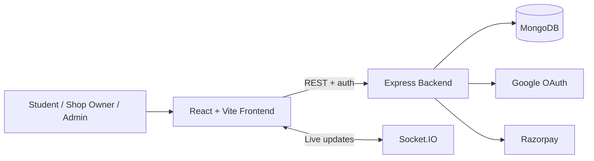

# Campus Food Court — Frontend

A React/Vite frontend for campus food ordering, with student, shop-owner, and administrator experiences.

**Backend API:** https://github.com/KISHAN000053/rgipt-food-court-backend

## Features

- Browse campus shops and menus
- Cart, checkout, order history, and live order tracking
- Student profile and support pages
- Shop-owner dashboard and menu/order management
- Admin screens for campus operations
- Google sign-in through the backend
- REST API integration and Socket.IO client support
- Responsive UI, route-based code splitting, and Vite production builds

## Architecture



## Stack

React 18 · Vite 5 · Tailwind CSS 3 · React Router 6 · TanStack Query 5 · Axios · Socket.IO Client · Lucide

## Local development

Requirements: Node.js and npm, plus a running backend.

```bash
npm install
cp .env.example .env
npm run dev
```

Vite normally serves the app at http://localhost:5173. For local development, leave `VITE_API_URL` empty; the included Vite proxy sends `/api` requests to `localhost:5000`. If you change the backend port, update `vite.config.js` as well.

For production, set `VITE_API_URL` to the deployed backend's base URL. Configure `VITE_CAMPUS_NAME` to change the navbar brand. Only put public configuration in `VITE_*` variables: Vite embeds these values in client-side assets.

Useful commands:

```bash
npm run dev
npm run build
npm run preview
```

## Main routes

| Route | Purpose |
|---|---|
| `/` | Landing and sign-in |
| `/home` | Shop listing |
| `/shops/:id/menu` | Shop menu |
| `/cart` | Cart |
| `/orders`, `/orders/:id` | Order history and tracking |
| `/profile` | User profile |
| `/admin/*` | Admin screens |
| `/shop-owner/*` | Shop-owner screens |

Some routes require authentication and a corresponding role on the backend. Frontend route hiding is not a security boundary.

## Deployment (Vercel)

1. Import this repository into Vercel.
2. Select the Vite framework preset.
3. Set `VITE_API_URL` to the deployed backend URL.
4. Set `VITE_CAMPUS_NAME` to your chosen campus brand.
5. Deploy. The included Vercel configuration should handle client-side routing.

Also configure the backend's CORS and OAuth callback settings for the deployed frontend URL.

## Reuse for another campus

Before deploying a fork:
1. Set the campus name in `VITE_CAMPUS_NAME`.
2. Review remaining campus-specific labels and content; the landing page and backend authentication policy must match the intended campus.
3. Configure the Google OAuth flow and authorized redirect URI.
4. Configure the backend URL and ensure backend CORS allows this frontend origin.
5. Verify student email-domain rules, admin identities, hostel/room fields, and campus-specific seed data in the backend.
6. Test student, shop-owner, and admin flows with separate accounts, including payment and order-status updates.

This project is a campus-specific starting point, not a multi-tenant SaaS system. Do not serve multiple colleges from one database unless tenant isolation is designed and enforced throughout the backend.

## Detailed guide

See [docs/DEPLOYMENT.md](docs/DEPLOYMENT.md) for local setup, Vercel deployment, campus configuration, and pre-launch checks.

## Security and production checklist

- Never commit `.env`, API keys, database credentials, OAuth client secrets, JWT secrets, or payment secrets.
- Rotate any credential that has been exposed; removing it from the latest commit does not remove it from Git history.
- Use strong unique production secrets and restrict database network access.
- Validate permissions and input on the backend; do not trust client-side role checks.
- Use HTTPS and test OAuth, CORS, payment verification/webhooks, and error handling before taking real orders.

## Contributing and security

See [CONTRIBUTING.md](CONTRIBUTING.md) for development checks and [SECURITY.md](SECURITY.md) for vulnerability reporting and secret-rotation guidance.

## License

This repository includes an MIT license, permitting commercial use, modification, and redistribution subject to its terms. Third-party services and assets have their own terms. This README is not a guarantee of production readiness.
